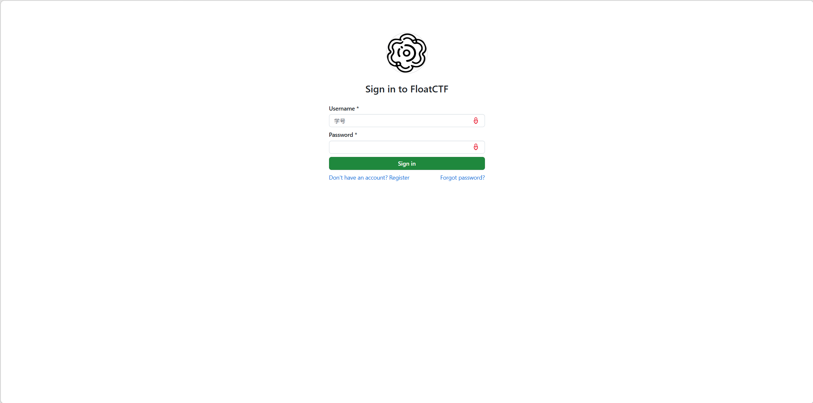
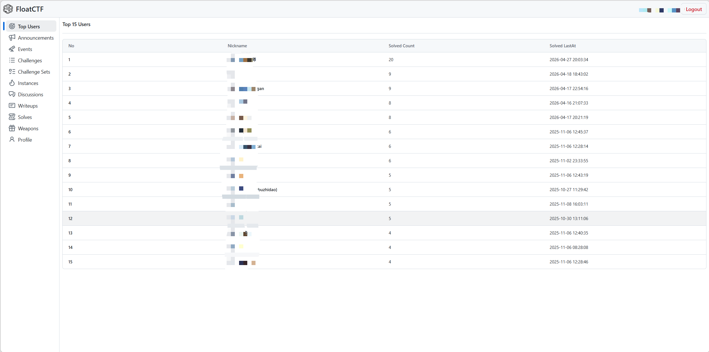
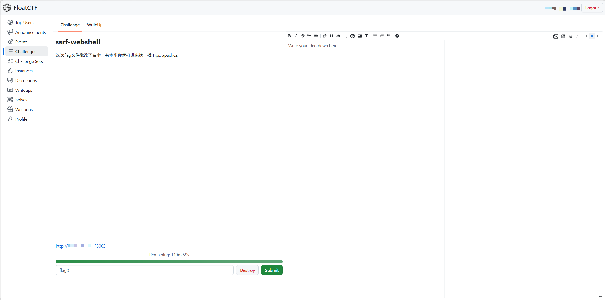
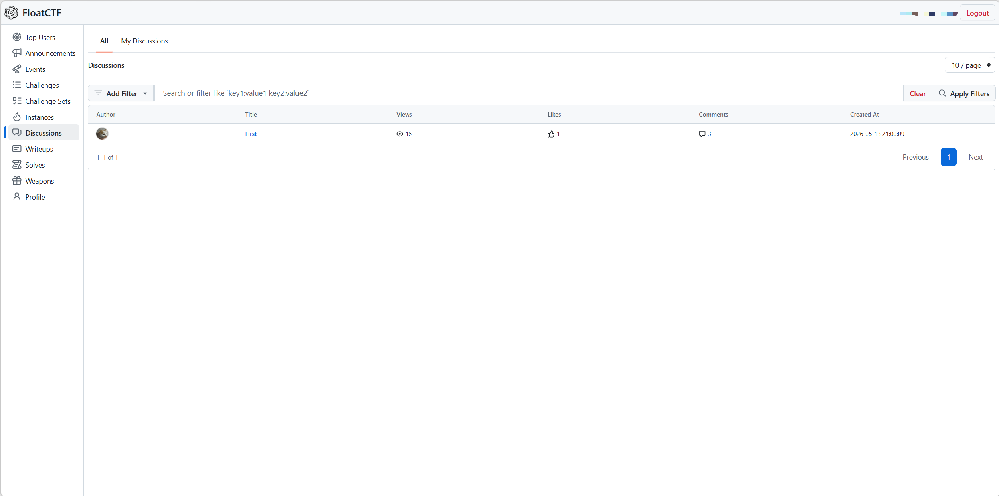
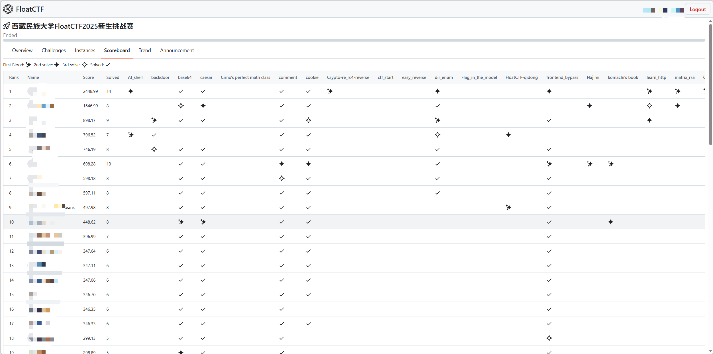
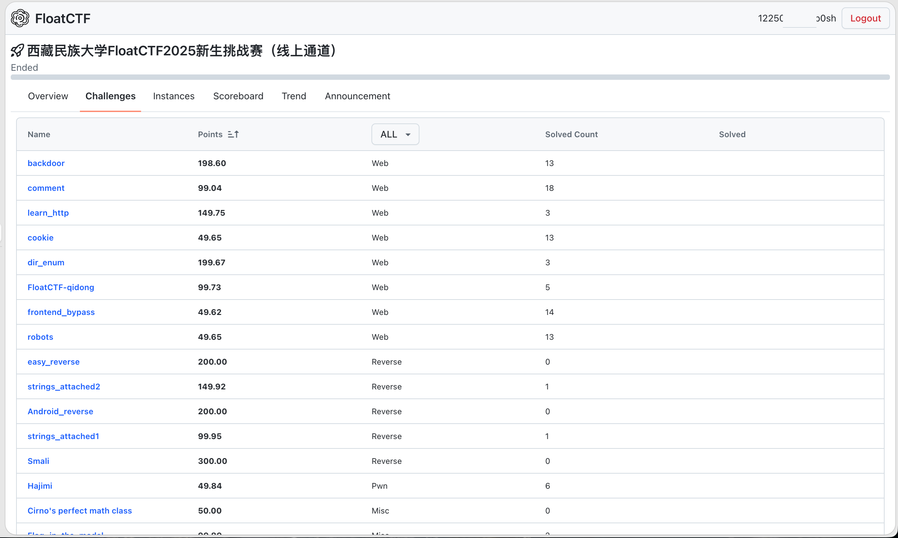
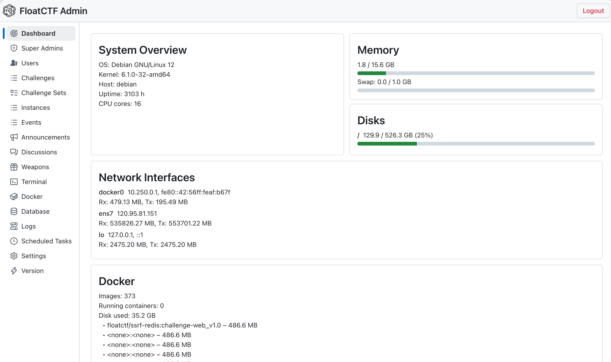
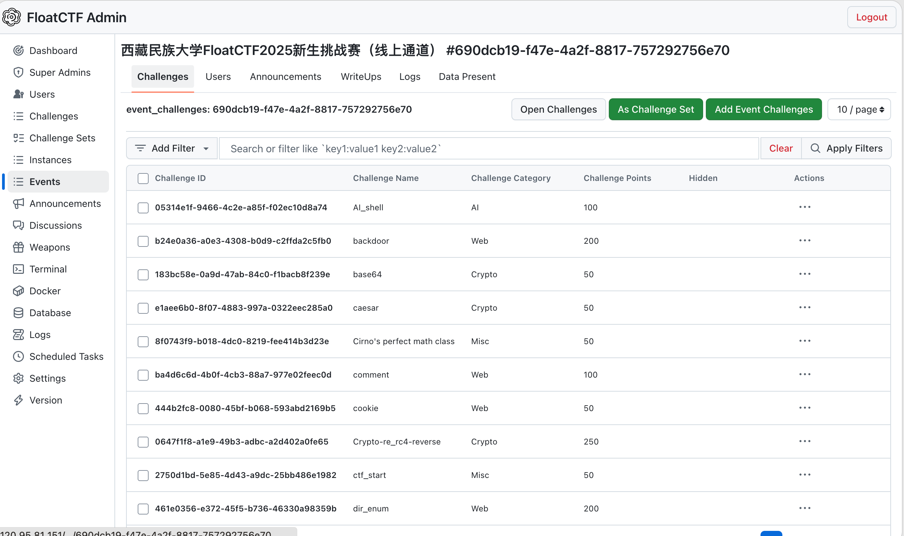
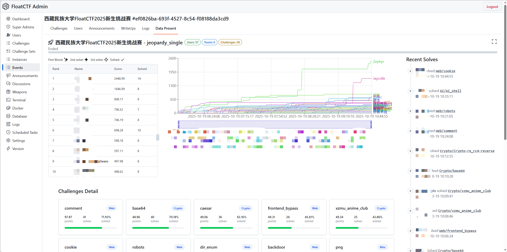

<h1 align="center">
  
  <br>
  FloatCTF
  <br>
</h1>

<h3 align="center">
A CTF Platform based on <a href="https://rust-lang.org/">Rust</a>.
</h3>


[](https://actix.rs/)
[](https://www.sea-ql.org/SeaORM/)
[](https://zed.dev/)


[](https://tanstack.com/router)
[](https://tanstack.com/query)

## Star History


## 目录

- [简述](#简述)
- [项目仓库](#项目仓库)
- [架构说明](#架构说明)
- [环境要求](#环境要求)
- [快速开始](#快速开始)
- [功能展示](#功能展示)
- [核心功能](#核心功能)
- [AWD 攻防对抗](#awd-攻防对抗)
- [技术栈](#技术栈)
- [技术亮点](#技术亮点)
- [文档导航](#文档导航)
- [许可证](#许可证)

## 简述

基于 Rust 的开源 CTF 实训及竞赛平台

## 项目仓库

FloatCTF 采用 Monorepo 结构，应用、共享 crate 和仓库级工具统一维护：

| 仓库                                                                   | 说明                                      |
| ---------------------------------------------------------------------- | ----------------------------------------- |
| `apps/api`                                                             | 后端 API（Rust / Actix Web）              |
| `apps/web`                                                             | **Web bootstrap**：解析并加载已安装前端（无 React / 无 UI） |
| `frontends/default`                                                    | **官方前端**：当前完整 UI（React + TanStack Router + Primer） |
| `packages/sdk`                                                         | `@floatctf/sdk`：框架无关的客户端（传输 / 错误模型 / 领域 API / SSE / DTO） |
| `packages/react`                                                       | `@floatctf/react`：可选 headless React 绑定（无 UI） |
| `packages/frontend-runtime`                                            | `@floatctf/frontend-runtime`：前端制品 / 运行时契约与 bootstrap 加载器 |
| `crates/fcmc`                                                          | 共享容器管理与出题工具（crates.io: `cargo install fcmc`） |
| `crates/awd-flagserver`                                                | AWD FlagServer 独立服务                  |
| `crates/awd-judgeserver`                                               | AWD JudgeServer 独立服务                 |
| `crates/awdp-judgeserver`                                              | AWDP（攻防+补丁）JudgeServer 独立服务      |
| `crates/helper-protocol`                                             | API ↔ helper Host RPC 协议                  |
| `crates/floatctf-helper`                                             | Docker + 网络宿主控制面守护进程             |

**赛事相关：**

| 仓库                                                                                                 | 说明         |
| ---------------------------------------------------------------------------------------------------- | ------------ |
| [challenges-xxxxxxxx-xxxxx-template](https://github.com/FloatCTF/challenges-xxxxxxxx-xxxxx-template) | 赛事模板     |

## 架构说明

FloatCTF 采用「容器化应用面 + 独立宿主控制面」架构。生产 API、PostgreSQL、Redis、RustFS、Caddy 都由 Docker Compose 管理；只有需要操作宿主 Docker/网络的 `floatctf-helper` 常驻 systemd：

```text
Internet
  ↓
Caddy container :80/:443
  ├── Web static
  ├── /api/* ───────────────► FloatCTF API container :9090
  └── object paths ─────────► RustFS
                                   │
FloatCTF API container            ├── PostgreSQL / Redis / RustFS（Compose DNS）
  ├── non-root / cap_drop=ALL / read-only rootfs
  ├── /run/floatctf/helper-control.sock ───────► Host RPC
  └── /run/floatctf/helper-docker.sock ► Docker policy proxy
                                              ↓
                                        floatctf-helper
                                        ├── docker group → Docker Engine
                                        └── CAP_NET_ADMIN
                                            ├── WireGuard
                                            ├── nftables
                                            ├── conntrack
                                            └── Docker FORWARD
```

生产 systemd 只管理宿主 helper 与 Compose 生命周期：

| 单元 | 内容 |
| --- | --- |
| `floatctf-helper.service` | 宿主控制面：Docker group + `CAP_NET_ADMIN` |
| `floatctf-infra.service` | `docker compose up/down`：API + PostgreSQL + Redis + RustFS + Caddy |
| `floatctf.target` | 聚合整个平台 |

### 可插拔前端（Pluggable Frontends）

**前端 ≠ 主题**。一个前端是一个**完整的可替换浏览器应用**（自己的框架、路由、页面层级、
布局、导航、登录 UX、管理端 UX 与设计系统）；不同前端不要求有相同的页面或路由路径。

```text
FloatCTF Backend ── REST / SSE / Bearer ──► @floatctf/sdk
                                              │
                              ┌───────────────┴───────────────┐
                              ▼                               ▼
                       @floatctf/react                  （任意非 React 前端）
                              │                               │
                              └───────────► Frontend ◄────────┘
                    官方：frontends/default      第三方：独立仓库

@floatctf/frontend-runtime = 制品/运行时契约（框架无关）
apps/web                  = 极薄的 bootstrap 引导页
```

详见 [ARCHITECTURE.md](docs/frontend/ARCHITECTURE.md)、[DEVELOPING.md](docs/frontend/DEVELOPING.md)、[ARTIFACT.md](docs/frontend/ARTIFACT.md)。写新前端从 [AI-FRONTEND-GUIDE.md](docs/frontend/AI-FRONTEND-GUIDE.md) 起步，能力清单见 [CAPABILITY-MATRIX.md](docs/frontend/CAPABILITY-MATRIX.md)；`frontends/default` 只是语义/行为参照，不是视觉模板。

#### 前端实现

官方前端随本仓库发布，第三方前端各自建仓、由 **submodule** 固定提交。XZMU 与 Shadcn 均覆盖全部 `required` 能力：

| 前端 | id | 位置 | 说明 | 详情 |
|---|---|---|---|---|
| Default | `default` | `frontends/default` | 官方完整前端，`protected`、不可卸载，`?frontend=default` 破窗落点 | [README](frontends/default/README.md) · [截图](frontends/default/docs/images) |
| XZMU | `xzmu` | [floatctf-frontend-xzmu](https://github.com/FloatCTF/floatctf-frontend-xzmu) | 民大红 · 鎏金，零组件库 + 自研 CSS | [README](https://github.com/FloatCTF/floatctf-frontend-xzmu/blob/main/README.md) · [截图](https://github.com/FloatCTF/floatctf-frontend-xzmu/tree/main/docs/images) |
| Shadcn | `shadcn` | [floatctf-frontend-shadcn](https://github.com/FloatCTF/floatctf-frontend-shadcn) | Tailwind v4 + shadcn/ui，双工作区 + AWD 驾驶舱 + ⌘K | [README](frontends/floatctf-frontend-shadcn/README.md) · [截图](frontends/floatctf-frontend-shadcn/docs/images) |

```bash
git clone --recurse-submodules git@github.com:FloatCTF/floatctf.git
```

> submodule 只存提交指针，文件不在本仓库树里，故第三方链接用绝对 URL；改它就先进其目录提交，再回来更新指针。新前端按 [ARTIFACT.md](docs/frontend/ARTIFACT.md) 打包后 `frontend.sh install` 安装。

## 环境要求

生产与完整开发环境均需 Linux + systemd、Docker Engine + Compose v2、nftables、WireGuard、iproute2、conntrack、iptables，以及 IPv4 转发和 `br_netfilter`（自动安装路径验证于 Arch Linux）。生产安装另需 `python3` ≥ 3.11（`migrate.sh` 用 stdlib `tomllib` 解析配置）与出网能力。完整清单与内核参数见 [INSTALL.md](./INSTALL.md) §5。

## 快速开始

### 生产部署

```bash
curl -fsSL https://github.com/FloatCTF/floatctf/releases/download/<tag>/install.sh -o install.sh
sudo env SITE_ADDRESS=ctf.example.com bash install.sh
sudo systemctl start floatctf.target
```

默认安装根为 `/var/lib/floatctf`（可用 `FLOATCTF_HOME` 覆盖），备份 / 恢复 / 卸载脚本随安装落在该目录。产物清单、升级语义与全部开关见 [INSTALL.md](./INSTALL.md)，发布渠道与产物契约见 [RELEASE.md](./RELEASE.md)。

> ⚠️ **单控制面不变量（R1）**：同一宿主 / helper / Docker daemon 同一时刻只允许一个 FloatCTF 控制面。第二套 API（开发栈、RC 或第二份安装）会 reconcile 固定命名的宿主资源并干扰线上实例 —— **绝不要在承载生产实例的宿主上运行 `mise run dev`**。详见 [INSTALL.md](./INSTALL.md) §0。

### 本地开发

```bash
curl https://mise.run | sh        # 按提示激活 shell
git clone https://github.com/FloatCTF/floatctf.git && cd floatctf
mise run setup                    # 工具链 + Docker/WireGuard/nftables + floatctf-helper
mise run dev                      # 唯一开发入口：infra + migrations + API + Vite
```

开发入口为 `http://<host>:7780`；内置账号：用户端 `1000000` / `testuser`，管理端 `/admin` 为 `sysadmin` / `FloatCTF@2025`。命令速查、权限模型、数据库迁移与开发侧故障排查见 [DEVELOPMENT.md](./DEVELOPMENT.md)。

## 功能展示

### 用户端

|            登录页面             |          天梯排行榜          |             做题页              |
| :-----------------------------: | :--------------------------: | :-----------------------------: |
|  |  |  |

|              讨论页              |             积分看板              |
| :------------------------------: | :-------------------------------: |
|  |  |

|           比赛题目页           |
| :----------------------------: |
|  |

### 管理端

|              概览              |
| :----------------------------: |
|  |

|            赛题管理            |            数据大屏             |
| :----------------------------: | :-----------------------------: |
|  |  |

> 以上是官方 **Default** 前端的截图。
> 其它前端有自己的视觉语言 —— 例如 `xzmu`（西藏民族大学「民大红 · 鎏金」主题），
> 它住在独立仓库 [FloatCTF/floatctf-frontend-xzmu](https://github.com/FloatCTF/floatctf-frontend-xzmu)：

|                登录                 |                 选手总览                  |               控制台总览                |
| :---------------------------------: | :---------------------------------------: | :-------------------------------------: |
|  |  |  |

完整逐页截图见 [xzmu 的 README](https://github.com/FloatCTF/floatctf-frontend-xzmu/blob/main/README.md#3-界面截图)。

## 核心功能

### 用户端

- **登录注册** — 学号注册、JWT 令牌鉴权、Argon2 密码加密、密码重置
- **首页 / 天梯排行榜** — 实时展示解题排名，长期积累激发自主学习动力
- **题单 / 做题** — 按 Web / Pwn / Crypto / Reverse / Misc 分类浏览，点击开启即自动创建独立 Docker 容器；支持教师发布"题单"组合专项训练
- **Discussion 讨论** — 在线论坛，支持同学间进行彼此学习交流
- **比赛 / 积分看板** — 支持 Jeopardy（解题赛）和 AWD（攻防对抗）两种赛制，提供实时积分看板、得分趋势图、一血标记、赛事公告

### 管理端

- **赛事概览** — 可视化系统状态看板，实时展示服务器负载、内存/磁盘使用率、网络流量
- **赛事细节管理** — 题目增删改查、Docker 镜像配置、端口映射、附件上传、积分规则配置
- **日志** — 操作日志与审计记录查询
- **Docker** — 查看所有运行中的容器实例，支持强制销毁异常容器，释放服务器资源
- **Tasks** — 任务队列管理与调度

## AWD 攻防对抗

AWD（Attack With Defense）是平台的核心特色功能。通过 Docker 自定义网桥与 WireGuard VPN 构建混合网络架构，为每个参赛队伍分配独立虚拟子网，实现环境隔离与流量可控。选手通过 WireGuard 客户端接入竞赛内网，攻击其他队伍靶机、防御己方靶机，还原真实内网攻防场景。

## 技术栈

| 模块     | 技术选型                               | 说明                                 |
| -------- | -------------------------------------- | ------------------------------------ |
| 后端语言 | Rust                                   | 系统级高性能语言，编译期内存安全保障 |
| Web 框架 | Actix Web                              | 异步高并发 Web 框架                  |
| ORM      | SeaORM                                 | 类型安全的异步 ORM                   |
| 数据库   | PostgreSQL 17                          | 关系型数据库                         |
| 对象存储 | RustFS                                 | S3 兼容对象存储                      |
| 前端框架 | React + TanStack Query + Primer Design | 流畅交互体验                         |
| 容器技术 | Docker / Docker Compose                | 题目环境隔离与部署                   |
| VPN      | WireGuard                              | AWD 竞赛网络隔离                     |
| 身份认证 | JWT + Argon2                           | 令牌鉴权 + 高强度密码哈希            |
| 反向代理 | Caddy 2                                | 自动 HTTPS、静态文件服务与 API 代理  |

## 技术亮点

- **高性能** — Rust + Actix Web 异步架构，数百人同时提交 Flag 时 API 响应延迟可控制在 100ms 以内
- **安全可靠** — Rust 所有权机制从编译期杜绝内存安全隐患；JWT 权限校验、Argon2 密码加密、容器资源限制多层保障
- **环境隔离** — 每道题目独立 Docker 容器，秒级启动、自动超时回收；AWD 模式下 WireGuard 子网隔离
- **动态积分** — 基于平方根函数的积分衰减算法，分值随解题人数非线性下降，兼顾区分度与公平性
- **一键部署** — `install.sh` 拉取产物与运行时镜像、构建非 root API 镜像、渲染 Compose/Caddy/TOML 并由 systemd 管理生命周期；`uninstall.sh` 覆盖安全卸载与 purge

## 文档导航

| 文档 | 内容 |
| --- | --- |
| [INSTALL.md](./INSTALL.md) | 生产安装、产物与镜像、运维、备份 / 恢复、卸载、故障排查；**§0 是 R1 单控制面不变量** |
| [DEVELOPMENT.md](./DEVELOPMENT.md) | 开发环境准备、权限模型、日常命令、数据库迁移、开发侧故障排查 |
| [RELEASE.md](./RELEASE.md) | 发布清单、产物契约（GitHub Release / Docker Hub）、打 tag 与回滚 |
| [AGENTS.md](./AGENTS.md) | AI 编码助手入口：铁律、常用命令、开发环境速记 |
| [docs/agents/](./docs/agents/README.md) | AI 工作手册：架构速览、新功能、修 bug、数据库、测试、前端数据请求 |
| [docs/frontend/](./docs/frontend/AI-FRONTEND-GUIDE.md) | 可插拔前端：运行时架构、开发、制品、能力矩阵、AI 前端指南 |
| [docs/identity/](./docs/identity/oidc-provider.md) | OIDC Provider：设计决策、第三方接入、运维与 key 轮换 |
| [frontends/default/](./frontends/default/README.md) | 官方前端：逐页截图、路由一览、开发与构建 |

## 许可证

本项目以 [GNU AGPLv3](LICENSE) 协议发布。Copyright (C) 2025-2026 fb0sh@outlook.com
