# OIDC Provider 测试报告（oidc 分支）

- 日期：2026-10-23；基线 `main@7c382e6`；分支 `oidc`
- 环境：Fedora Linux 宿主；隔离测试栈（独立容器 PostgreSQL 17 / Redis 7 / RustFS，非开发库、非生产）；
  API 为本分支 debug 构建，`awd.network_runtime = "noop"`，Docker 只接一个仅响应 `_ping` 的桩 socket（本机未安装 floatctf-helper）。
- **结论边界**：以下均为本地 / 本地 TLS staging 实测，**未部署到任何生产或公网环境**；FloatCTF **未取得** OpenID Foundation 认证。

## 1. 自动化测试

| 套件 | 命令 | 结果 |
|------|------|------|
| Rust 单元（oidc / jwt / config 等） | `cargo test -p floatctf --lib -- oidc` | 59 passed（`-- oidc jwt config` 合计 99 passed） |
| Discovery / JWKS 契约 | `cargo test -p floatctf --test oidc_discovery` | 3 passed |
| 协议闭环 + 反例矩阵（真实 PostgreSQL） | `DATABASE_URL=… cargo test -p floatctf --test oidc_flow` | 12 passed |
| SSO / 开发者中心 / 审核（真实 PostgreSQL） | `DATABASE_URL=… cargo test -p floatctf --test oidc_management` | 4 passed |
| 鉴权契约（运行中的 API） | `FLOATCTF_API_BASE=… FLOATCTF_API_REQUIRE=1 cargo test --test http_auth_contract` | 4 passed；选手 69 / 管理 103 条受保护路由匿名拒绝 |
| 限流 + 终端 ticket（真实 Redis，串行） | `TEST_REDIS_URL=… cargo test --lib -- redis_tests --test-threads=1` | 8 passed |
| 全量 Rust 回归 | `scripts/test-rust.sh`（一次性数据库） | 855 passed / 6 failed / 9 ignored（见下） |
| SDK / frontend-runtime / react / Default Frontend | `pnpm run test:web` | 64 / 109 / 15 / 174 passed |
| Default Frontend 构建 | `pnpm --filter @floatctf/frontend-default build`（`vite build && tsc --noEmit`） | 通过 |
| 前端架构边界 | `scripts/check-architecture.sh` | OK |
| 安装器契约（含 Caddyfile 镜像逐字节一致） | `scripts/test-installer-contract.sh` | 114/114 |

**回归中的 6 个失败**：全部是 `tests/awdp_training.rs`，原因是本机没有本地镜像
`floatctf/test-g:gamebox-v1.0.3`；在改动前的基线（Phase 0）上同样失败，与 OIDC 无关。
**已知测试隔离问题（既有）**：设置 `TEST_REDIS_URL` 并行运行时，限流测试与终端 ticket 测试都会 `FLUSHDB` 同一个 Redis，
偶发互相干扰；串行运行全部通过。

`oidc_flow` 覆盖的反例：授权码重放（并撤销已签发 token）、8 路并发兑换至多成功 1 次、跨 client 兑换、redirect_uri
不一致 / 缺失、错误 / 缺失 code_verifier、PKCE 降级（无 challenge 却带 verifier）、过期授权码、错误 secret、
认证方式与登记不符、无客户端认证、非 form 请求、GET 兑换、伪造授权码；未登记回调 / 未知 client / 停用应用不重定向；
`prompt=none`（login_required / consent_required）、拒绝授权、`max_age=0` 与 `prompt=login` 强制重新认证；
伪造 access token、ID Token 当 access token、OIDC 令牌访问平台 API、应用禁用 / 授权撤销即时失效；
CSRF 错误、换浏览器、跨站 Origin、事务重放；登出后服务端撤销；登录限流；过期数据清理。

## 2. 标准客户端互操作（真实 API 二进制）

HTTPS staging：Caddy `tls internal`（客户端以 Caddy 根证书校验 TLS，未关闭校验），issuer `https://localhost:9443`。
同一用户代理（Cookie jar）依次登录三个 RP：

| RP 库 | 客户端类型 / 认证 | 结果 |
|-------|------------------|------|
| Python Authlib 1.3.2（`CodeIDToken` 校验 iss/aud/exp/nonce/at_hash，显式校验 RFC 9207 `iss`） | 机密 / `client_secret_basic` + PKCE | PASS（首次输入密码） |
| Node openid-client 6.8.8（OpenID 认证 RP 库） | 公开 / `none` + PKCE | PASS，**未再要求密码** |
| Go coreos/go-oidc v3.11.0 + x/oauth2 v0.24.0 | 机密 / `client_secret_post` + PKCE | PASS，**未再要求密码** |

三者得到相同 `sub`、不同 `aud`；`email_verified=false`。HTTP 本地 issuer 下 Authlib 与 openid-client 同样通过。

**未测**：Supabase Auth（LearnOS 使用）——本次未搭建 GoTrue 环境，不声称兼容，接入前需在其环境实测。

## 3. 真实浏览器 E2E（Playwright Chromium）

拓扑：Caddy（同源反代 `/api/*`、`/oauth/*`、`/.well-known/*` → API，其余 → Default Frontend Vite）+
Demo RP（Node `http` + openid-client，机密客户端，位于另一个站点 `127.0.0.1:18081`）。

1. 开发者在 Default Frontend「Developer Apps」新建机密应用 → secret 一次性弹窗（截图 `images/developer-secret-once.png`，测试库数据，已作废）。
2. 管理员在「Admin → OIDC Clients」批准。
3. 开发者登出：其 SSO 会话在库中标记撤销；页面 JS 读不到 Cookie（`document.cookie === ""`，HttpOnly）。
4. 选手在 FloatCTF 登录页正常登录 → 打开 Demo RP 点「Sign in with FloatCTF」→ **直接到同意页，没有密码框**
   （`images/consent-after-floatctf-login.png`）→ 允许 → RP 显示已登录、`iss/sub/aud/auth_time` 正确。
5. RP 登出后再次登录：不经过任何 FloatCTF 页面，静默完成（已授权 + SSO）。
6. 「Authorized Apps」撤销（`images/authorized-apps-revoke.png`）→ 再次登录需要重新同意（仍无需密码）。
7. FloatCTF 登出 → RP 登录进入 OIDC 登录页（需要密码）；登录、同意后成功；`auth_time` 为新的认证时间。
8. 移动端宽度 + 暗色（`images/login-mobile-dark.png`）、`prompt=login` 提示、取消 → RP 收到 `access_denied`。

此 E2E 发现并修复了一个进程内测试无法暴露的缺陷：页面 `Referrer-Policy: no-referrer` 会让浏览器表单 POST 携带
`Origin: null`，被同源校验误拒；已改为 `same-origin` 并加回归测试。

## 4. 签名 key 轮换与多实例

| 步骤 | 结果 |
|------|------|
| key-1 active、key-2 预发布 | JWKS=[key-1,key-2]；新 ID Token `kid=key-1`，验签通过 |
| 切换 key-2 active（key-1 保留） | 新 ID Token `kid=key-2`；旧 `kid=key-1` 令牌仍验签通过 |
| 退役 key-1 | JWKS=[key-2]；`kid=key-1` 令牌被拒，`kid=key-2` 通过 |
| 两个 API 实例共享 key 文件 | JWKS、Discovery 字节一致 |
| 平台 HS512 JWT | 不受 OIDC key 轮换影响 |
| 重启 | JWKS 字节一致（持久化 key，非临时生成） |
| 缺 key 文件 / 非 loopback 的 http issuer | API 拒绝启动（exit≠0） |

## 5. OpenID Foundation Conformance Suite

- 版本：`registry.gitlab.com/openid/conformance-suite:latest`（镜像 `sha256:efe8fcb9…`，2026-10-23 构建；导出格式 5.3.3），仓库 `1422973`
- 计划：`oidcc-basic-certification-test-plan[server_metadata=discovery][client_registration=static_client]`
- OP：`https://host.docker.internal:9443`（Caddy 内部 CA）；3 个静态客户端（basic ×2、post ×1）；
  由于该计划的大部分模块不发送 PKCE，测试客户端由管理员 API 设置了 PKCE 豁免（`require_pkce=false`，此时强制 `nonce`）。
- 结果（35 个模块）：**22 PASSED、4 REVIEW、3 WARNING、5 SKIPPED、1 FAILED**；1663 条成功条件、1 条失败、3 条警告。

| 结果 | 模块 | 说明 |
|------|------|------|
| FAILED | `oidcc-ensure-request-without-nonce-succeeds-for-code-flow` | **有意为之**：对豁免 PKCE 的机密客户端，本 OP 要求 `nonce`（RFC 9700 §2.1.1：不用 PKCE 时须用 nonce 防授权码注入）。默认（强制 PKCE）客户端不带 nonce 时只要带 PKCE 即可成功 |
| REVIEW | `oidcc-prompt-login`、`oidcc-max-age-1` | 套件自动截取了第二次授权时的页面：均为要求重新输入密码的登录页（"该应用要求你重新验证身份"），授权最终成功。需人工审阅确认 |
| REVIEW | `oidcc-ensure-registered-redirect-uri`、`oidcc-ensure-request-object-with-redirect-uri` | 截取页面为 FloatCTF 错误页"回调地址（redirect_uri）与该应用登记的地址不一致"，**未重定向**。需人工审阅确认 |
| WARNING | `oidcc-scope-profile` | `profile` 只返回 `preferred_username/nickname/name/picture/updated_at`，没有 `given_name/family_name/...`（平台无此数据） |
| WARNING | `oidcc-ensure-request-with-acr-values-succeeds` | 不支持 `acr`，ID Token 不含 `acr` |
| WARNING | `oidcc-claims-essential` | 不支持 `claims` 请求参数（Discovery 已声明 `claims_parameter_supported=false`） |
| SKIPPED | `oidcc-scope-address`、`oidcc-scope-phone`、`oidcc-scope-all`、`oidcc-refresh-token`、`oidcc-unsigned-request-object-…` | 对应能力未实现且未宣告 |
| PASSED | 其余 22 个（含 server、userinfo get/post-header/post-body、scope-email、alternate-happy-flow、display、prompt-none ×2、max-age-10000、unknown-parameter、id-token-hint、login-hint、ui/claims-locales、codereuse、codereuse-30seconds、post-request、client-secret-post、valid-pkce） | |

过程中两次修正：首轮运行因测试配置问题（同意页 email 勾选未设为可选、缺 `client_secret_post` 客户端）中断；
同时根据警告 `EnsureIdTokenDoesNotContainEmailForScopeEmail`，把 ID Token 改为只含身份 claims（资料 claims 只经 UserInfo），
修改后 `oidcc-scope-email`、`oidcc-alternate-happy-flow` 由 WARNING 变为 PASSED。
REVIEW 项由本次实施者对照截取的页面源码确认行为正确，**不是** OIDF 官方审阅结论。

## 6. Definition of Done 状态

| DoD 项 | 状态 | 证据 / 缺口 |
|--------|------|-------------|
| 通用 OIDC Client 从 Discovery 自动接入，无需私有 SDK | ✅ | §2 三个库只用 issuer/client_id/secret/redirect |
| 第三方登记 Client、回调与 scope 并获得凭据 | ✅ | §3、`oidc_management` |
| Authorization Code + PKCE S256，含确认与拒绝 | ✅ | `oidc_flow`、§3 |
| ID Token `iss/aud/sub/exp/iat/nonce/kid` 正确，JWKS 可验 | ✅ | §2、§4、OIDF `oidcc-server` |
| UserInfo 按 scope 返回，不含敏感业务数据 | ✅ | `oidc_flow`、OIDF userinfo/scope 测试 |
| 浏览器真正 SSO | ✅ | §3 第 4 步 |
| 重放 / 跨 client / 跨 redirect / 错误 PKCE / 过期 fail closed | ✅ | §1 反例 |
| 用户撤销；开发者只管自己的应用；管理员审核 / 禁用 | ✅ | `oidc_management`、§3 |
| 旧登录 / JWT / 用户 / 赛事核心无回归 | ✅（有限） | 全量回归与基线一致；赛事业务只经既有自动化测试，未做人工赛事演练 |
| 单元 / 集成 / HTTP / 浏览器 E2E + ≥2 种外部客户端 | ✅ | §1–§3 |
| OIDF Conformance Suite 适用项运行并标记未通过项 | ✅ | §5（1 项有意失败、4 项待人工审阅） |
| 接入文档、错误与示例、部署与 TLS、key 轮换、故障与回滚 | ✅ | `oidc-provider.md`、`oidc-client-integration.md`、`oidc-operations.md` |

## 7. 未解决 / 风险

1. **未在真实公网 HTTPS（ACME 证书、真实域名）上部署验证**；staging 使用 Caddy 内部 CA。生产开启前按 `oidc-operations.md` §4 自检。
2. Supabase Auth / LearnOS 未实测。
3. `frontends/floatctf-frontend-shadcn`、`floatctf-frontend-xzmu` 是未检出的 submodule，未改动：若激活这些前端，
   新登录仍会由服务端下发 SSO Cookie，但需它们自行接入 `establishSso` / `endSso`（见 CAPABILITY-MATRIX OIDC 行）才能覆盖旧会话与登出撤销。
4. 不支持 Refresh Token、RP-Initiated / Back-Channel Logout、动态注册、Token 撤销 / 内省（未宣告）。
5. OIDC 登录页的 IP 限流依赖 `X-Forwarded-For` 首段；API 必须只经 Caddy 暴露（生产 Compose 已如此），否则 IP 维度可被伪造（用户名维度不受影响）。
6. Default Frontend 的 `GenericTable` 在 `disableSelect` 时会连操作列一起去掉（既有行为，本次未修改，新页面避开了该参数）。

## 8. 账号选择（`prompt=select_account`，2026-10-25，分支 `feat/oidc-account-chooser`）

设计见 [ADR-oidc-account-chooser.md](ADR-oidc-account-chooser.md)。环境：同上隔离测试栈（独立容器 PostgreSQL 17 / Redis 7 / RustFS，
Docker 只接 `_ping` 桩）；**未部署到任何生产或公网环境**。

### 8.1 自动化测试（FloatCTF）

| 套件 | 命令 | 结果 |
|------|------|------|
| OIDC 单元（含 `decide` prompt 组合矩阵、选择页模板转义、同源头像、回滚开关配置） | `cargo test -p floatctf --lib oidc` | 73 passed |
| 账号选择集成（真实 PostgreSQL） | `DATABASE_URL=… cargo test -p floatctf --test oidc_account_chooser` | 16 passed（并发用例连续 5 次稳定） |
| 既有协议 / SSO / Discovery 集成 | `… --test oidc_flow --test oidc_management --test oidc_discovery` | 12 / 4 / 3 passed（改动前基线同为 19 passed） |
| 全量 Rust 回归 | `scripts/test-rust.sh --no-fail-fast`（一次性数据库） | 1033 passed / 6 failed / 14 ignored；6 个失败全部是 `awdp_training`（本机缺本地镜像 `floatctf/test-g:gamebox-v1.0.3`，与 §1 记录的既有失败相同，与 OIDC 无关）；`mise run lint`（workspace clippy + 各前端 lint）通过 |
| Web 类型检查 / 架构边界 / 单测 / Default Frontend 构建 | `mise run web:typecheck`、`mise run web:architecture`、`pnpm run test:web`、`pnpm --filter @floatctf/frontend-default build` | 通过；64 / 109 / 15 / 174 passed（`frontend-shadcn` 为未检出 submodule） |
| 安装器契约 | `scripts/test-installer-contract.sh` | 114/114 |

`oidc_account_chooser` 覆盖：无 SSO 直达登录页；有 SSO 必现选择页、GET 可重复打开且不发码 / 不确认；继续当前账号不重新认证（`auth_time` 不变）
且已同意时不再同意；使用其他账号后旧 Cookie 不能回到 A（选择页 GET 送回登录页、旧 CSRF 失效、直接 POST 同意页失败）、
B 独立同意、A 旧会话被撤销、两条独立 consent；`consent` / `login` 不显示选择页且 `login` 刷新 `auth_time`；
`select_account consent`（两页）、`select_account login`（预填所选账号仍须密码）、`select_account` + `max_age=0`；
`prompt=none`（静默发码 / `consent_required` / 与 `select_account` 组合为 `invalid_request` / `login_required`）；
取消回传 `access_denied` + `state` + `iss` 且不影响 SSO；会话在展示后被撤销 / 过期 / 用户被删除都不能免密继续；
伪造 CSRF、换浏览器（只偷 SSO Cookie）、跨站 Origin、非表单、未知动作 / 事务、过期事务；伪造 `user_id` / `session_id` /
`username` 字段被忽略；另一标签切换账号后要求重新确认（选择页与同意页两条路径）；8 路并发「继续」只发 1 个码；
`id_token_hint` 指定 A 时 B 的正确密码不能建立会话或发码；事务中途应用被封禁后不能继续；同意页「使用其他账号」走切换状态；
不传 prompt 的旧 RP 与另一个 RP 行为不变；`account_chooser = false` 回滚到旧同意页。

### 8.2 真实浏览器双系统 E2E（LearnOS × FloatCTF）

- FloatCTF：本分支 API debug 构建，issuer `https://127.0.0.1:8443`；LearnOS：其 `feat/oidc-account-chooser` 分支生产构建
  （`next start`），`https://localhost:3443`；两者各自独立的 PostgreSQL。
- TLS：一次性测试 CA 签发证书；LearnOS 服务端 `NODE_EXTRA_CA_CERTS`、Chrome 独立 NSS 证书库信任该 CA，**未使用
  `ignoreHTTPSErrors` 或任何校验旁路**（无 CA 的 curl 访问会因 `unable to get local issuer certificate` 失败）。
- 账号与应用都通过 FloatCTF 公共 API 建立（`POST /api/users`、`POST /api/oidc/clients`）。
- 浏览器：系统 Google Chrome（Playwright `channel: chrome`）。用例：LearnOS `tests/e2e/floatctf-account-chooser.spec.ts`。

| # | 场景 | 结果 |
|---|------|------|
| 01 | 无 SSO：密码 → 同意 → LearnOS A；回调仅含 `code`/`state`/`iss` | ✅ |
| 02/03/17 | 退出 LearnOS（LearnOS 会话行被删、`/courses` 回登录页，FloatCTF `__Host-fctf_sso` 仍在）→ 再次登录**出现选择页**，等待 2 秒不返回、不发码 → 继续：无登录页、无同意页、恰好 1 个码，A 的报名仍在 | ✅ |
| 11 | 取消：`access_denied` + `state` + `iss`，LearnOS 显示「你已在 FloatCTF 取消登录」且无会话 | ✅ |
| 04/22 | 使用其他账号：登录页标题「使用其他账号登录」、用户名为空 → B 的密码 → B 自己的同意页 → LearnOS B；B 看不到 A 的报名与笔记；A 的 SSO 被替换 | ✅ |
| — | 之后选择页只展示 B，不出现 A | ✅ |
| 16 | 双击「继续」：码数 +1，最终身份为 B | ✅ |
| 15 | 标签 1 停在 B 的选择页，标签 2 切换为 A；标签 1 点继续 → 「登录账号已发生变化」+ 展示 A，不发码；再确认 → A | ✅ |
| 14 | 攻击者站点自动提交带正确 txn/csrf 的表单 → 「请求来源无效」，不发码 | ✅ |
| — | 未登记 `redirect_uri` → FloatCTF 400 错误页，不跳转 | ✅ |
| 20/09 | 不传 prompt 的旧 RP：首次只有该 RP 的同意页；之后 302 直接回调（无页面）；`prompt=none` 同样 | ✅ |
| 12 | FloatCTF 会话失效 → 直接登录页（不展示可继续的账号） | ✅ |
| — | 390px 暗色：无横向滚动；键盘 Enter 触发默认焦点「继续使用此账号」 | ✅ |

结果：12/12 通过，连续两次（LearnOS Better Auth 限流保持开启）。同一环境下 LearnOS 完整 `pnpm test:e2e`：38 passed / 6 skipped / 0 failed
（skipped 为 LearnOS 历史 Keycloak/Supabase 实测块，需其专用环境）。截图：

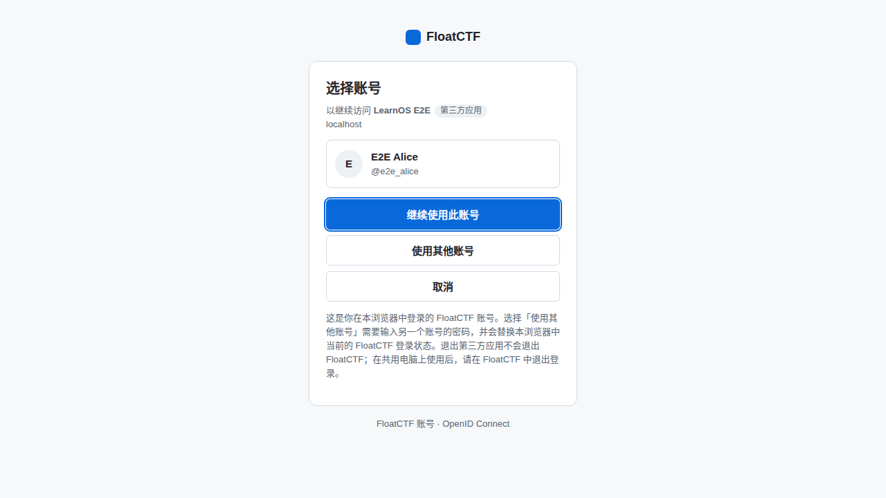
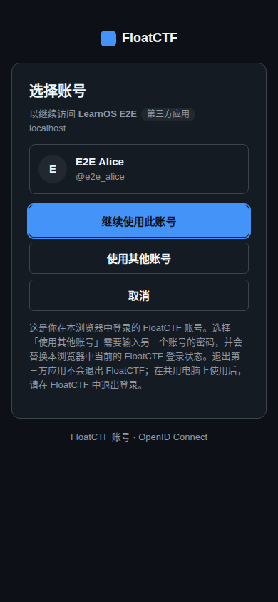

### 8.3 仍未覆盖 / 限制

1. 未在真实公网域名与生产拓扑（双 issuer 共用库）上验证；部署顺序与回滚见 ADR §2.4 与 `oidc-operations.md`。
2. 单当前会话：使用其他账号后原账号需重新输入密码；不支持多个账号同时保持登录（ADR §4，后续提案）。
3. 平台没有「停用用户」状态，PLAN 中「停用账号」场景以「用户被删除 → 会话失效」与 RP 侧停用（LearnOS `disabled_at`）覆盖。
4. 不实现统一退出（RP-Initiated / Back-Channel Logout）。

## 9. 统一身份（主站会话 × 多账号 × 标准退出，2026-10-26，分支 `feat/unified-identity`）

设计见 [ADR-unified-identity.md](ADR-unified-identity.md)，审计、威胁模型与执行矩阵见 [unified-identity-audit.md](unified-identity-audit.md)，
上线与回滚见 [oidc-operations.md](oidc-operations.md) §11。LearnOS 侧见其仓库 `docs/floatctf-unified-logout.md`。

**环境**：Fedora 宿主上的隔离测试栈——一次性容器 PostgreSQL 17（FloatCTF、LearnOS 各一个）/ Redis 7 / RustFS；
FloatCTF API 为本分支 debug 构建（`awd.network_runtime = "noop"`，Docker 只接 `_ping` 桩），Default Frontend 为本分支制品；
LearnOS 为其 `feat/unified-identity` 分支生产构建（`next start`）。Caddy 按 `scripts/install.sh` 内嵌模板提供
`https://ctf.localhost:8443`（API + `/public` → RustFS + 前端注册表）与 `https://learn.localhost:8444`。
TLS 由一次性测试 CA 签发，Chrome（独立 NSS 库）与 Node（`NODE_EXTRA_CA_CERTS`）都**校验证书**，没有 `ignoreHTTPSErrors`。
统一模式开关：`multi_account`、`unified_web_session`、`backchannel_logout` 全开，`backchannel_trusted_hosts = ["learn.localhost:8444", "learn.localhost:8446"]`
（8446 无人监听，用于网络不可达）。**未部署到任何生产或公网环境。**

### 9.1 自动化测试

| 套件 | 命令 | 结果 |
|------|------|------|
| 质量门禁 `mise run check`：fmt + lint（workspace clippy、五个前端 lint、`web:typecheck`、`web:architecture`） | `mise run check` | fmt、lint 通过（clippy 只有既有 warning；biome 0 error） |
| 质量门禁 `test` 阶段：Rust 全量（一次性兄弟库）+ Web 单测 + 前端管理器 | `scripts/test-rust.sh --no-fail-fast`、`pnpm run test:web`、`scripts/test-frontend-manager.sh`（`FLOATCTF_CONFIG` 指向隔离测试库的完整配置） | Rust **1075 passed / 6 failed / 14 ignored**——6 个失败全部是 `awdp_training`（本机缺本地镜像 `floatctf/test-g:gamebox-v1.0.3`，与 §1、§8 相同的既有失败，与本轮无关）；Web 69 / 109 / 15 / 189 passed；前端管理器 72/72。第一次 `mise run check` 因我给的基础 TOML 缺 `[server]`，一次性库没建成、`awd_score_semantics` 21 个用例在共享库上连接池超时；改用完整配置后该套件单独与全量均通过 |
| 统一会话集成（真实 PostgreSQL） | `cargo test -p floatctf --test oidc_unified_session` | 15 个用例（见下） |
| 标准退出集成（真实 PostgreSQL + 本地 HTTPS 接收端） | `cargo test -p floatctf --test oidc_standard_logout` | 7 个用例 |
| 页面资源 / 头像（真实 RustFS） | `cargo test -p floatctf --test oidc_pages_assets` | 3 个用例 |
| 账号选择（P2 重设计后全部保留） | `cargo test -p floatctf --test oidc_account_chooser` | 16 个用例 |
| OIDC 单元（`decide` 矩阵、模板转义、Logout Token claims、公网地址判定、配置校验等） | `cargo test -p floatctf --lib identity::oidc` | 83 passed |
| Default Frontend | `pnpm exec vitest run`、`biome lint`、`tsc --noEmit`、`vite build` | 189 passed；lint 0 error（5 条既有 warning）；tsc / build 通过 |
| 安装器契约（含参考 Caddyfile / prod TOML 与内嵌模板无漂移） | `scripts/test-installer-contract.sh` | 114/114 |
| LearnOS 单元 + 集成（含 Logout Token 10 项、Back-Channel 7 项） | `pnpm test` | 142 passed / 10 skipped |
| LearnOS 类型检查 / 构建 / 客户端密钥扫描 | `pnpm typecheck`、`pnpm build`、`pnpm security:scan` | 通过 |
| LearnOS lint | `pnpm lint` | **1 error**：`tests/integration/rls.test.ts` 的 `@ts-nocheck`——upstream/main 上已存在，与本轮无关，未修改 |

### 9.2 真实浏览器跨应用 E2E（Chrome × 真实 HTTPS）

LearnOS `tests/e2e/floatctf-unified-identity.spec.ts`：两个 FloatCTF 账号 A/B、四个独立浏览器上下文（浏览器 A、B 与设备 C、D）。
**17/17 passed**（`E2E_FLOATCTF_UNIFIED=1 pnpm exec playwright test tests/e2e/floatctf-unified-identity.spec.ts`）。

同一环境：LearnOS 全量 `pnpm exec playwright test` **43 passed / 18 skipped / 0 failed**（skipped = 只在旧模式或外部 IdP 环境运行的两套 FloatCTF spec）；
`floatctf-sso.spec.ts`（`E2E_FLOATCTF_SSO=1`）对统一模式 OP **12/12**；FloatCTF 开关全部关闭（旧模式）时
`floatctf-account-chooser.spec.ts` + `floatctf-sso.spec.ts` **18 passed / 6 skipped**。

最终证据运行（全部提交之后）：主机重启后按 LearnOS `docs/floatctf-unified-logout.md` §5 从零重建测试环境，统一模式 spec **17/17**、
旧模式两套 spec **18 passed / 6 skipped**；重启前同一代码的 LearnOS 全量 E2E **43 passed / 18 skipped / 0 failed**。

### 9.3 A01–A20

| ID | 结论 | 证据 |
|----|------|------|
| A01 主站密码登录 → LearnOS | **PASS** | E2E「A01/U01」：只有 HttpOnly + Secure + host-only `__Host-fctf_accounts`，`localStorage` 无令牌；选择页 1 个账号、点选即进入、全程无 `/oauth/login`；LearnOS 会话绑定的 `sid` 正是主站登录建立的身份会话。集成 `main_site_login_then_rp_chooser_continues_without_password`、`web_login_sets_only_an_httponly_container_cookie_and_returns_no_token` |
| A02 LearnOS OIDC → 主站 | **PASS** | E2E「A02/U03」：新浏览器在 LearnOS 经 FloatCTF 输入密码，打开主站直接进入 `/service` 且为同一账号。集成 `oidc_login_page_restores_main_site_without_password` |
| A03 LearnOS 本地退出 | **PASS** | E2E「A03/U04」：LearnOS 会话为空、主站仍登录；再次 SSO 先出选择页，免密码、无同意页。旧模式 spec 02/03/17 |
| A04 FloatCTF 普通退出 | **PASS** | E2E「A04/U05/U12」：该浏览器的身份会话 `revoked_at` 置位、主站未登录且无可选账号、另一浏览器同一用户的会话不受影响；LearnOS 会话仍可用；重新打开主站不会被静默恢复。集成 `main_site_logout_revokes_identity_session_and_never_silently_restores`、`ordinary_logout_never_notifies_relying_parties` |
| A05 退出后重新登录 LearnOS | **PASS** | E2E「A05」：FloatCTF 已退出时 LearnOS SSO 直达登录页，必须输入密码 |
| A06 退出请求失败 | **PASS** | E2E「A06」：注入网络中断与 HTTP 500，均弹出「退出未完成 … 当前登录状态没有改变」，页面仍在 `/service`，服务端会话列表不变。单测 `keeps the user signed in and explains when sign-out fails` |
| A07 同浏览器 A/B | **PASS** | E2E「A07/U06/U11」：主站添加 B 后选择页恰好 2 个真实账号；选 B 进入 B 自己的同意页（不继承 A 的授权），LearnOS 用户不同；库内两条独立 consent；RP 选 B 后主站当前账号仍是 A。集成 `rp_choosing_another_account_never_switches_the_main_site`、`password_login_rotates_container_secret_and_caps_accounts` |
| A08 并发与跨标签 | **PASS** | 集成 `concurrent_continue_issues_exactly_one_code`（统一与选择页两套，8 路并发只发 1 个码）、`account_change_in_another_tab_forces_reconfirmation_and_never_mixes_users`；E2E「A08」：一个标签切换账号，另一个标签同步；旧模式 spec 15/16 |
| A09 单账号 / 全部清理 | **PASS** | E2E「A09」：选择页「退出账号」只移除 B，主站随之只剩 A 且要求用户明确选择（不自动换人）；主站「退出本浏览器中的全部账号」后无任何账号，SSO 需要密码。集成 `chooser_signs_out_one_account_then_all_accounts` |
| A10 prompt 兼容 | **PASS** | E2E「A10/A11」（不带 prompt 的旧 RP）：多账号先选择；`prompt=none` → 302 `account_selection_required` + `state` + `iss`，不渲染页面；`prompt=login` 选中后仍要密码。集成 `consent_and_login_prompts_do_not_show_the_chooser`、`prompt_none_never_renders_the_chooser`、`legacy_rp_without_prompt_keeps_silent_sso`；旧模式 spec 20/09 |
| A11 `max_age=0`、`id_token_hint` | **PASS** | 集成 `id_token_hint_and_max_age_zero_with_several_accounts`（hint 只留下对应账号，`prompt=none` 静默成功；别人的正确密码不能满足 hint）、`id_token_hint_blocks_switching_to_a_different_account`；E2E `max_age=0` 选中后仍要密码 |
| A12 Logout Token 伪造 / 重放 | **PASS** | LearnOS 单元（伪造签名 / 他人密钥 / 错误算法、非 `logout+jwt`（如重放的 ID Token）、不受信 issuer / 错 aud、过期 / 未来 / 过旧、events / nonce / jti / 标识缺失或畸形、垃圾与超长输入、sid-only 与 sub-only）与集成（只撤销对应 sid 且立即失效；拒绝重放 / 错 aud / 错签名 / 不受信 issuer / 错 typ / 非表单且不删除任何会话；只有 sub；无会话返回 200；登录上下文隔离；provider-logout 回归）；E2E「A12」：真实端点拒绝非 JWT、他人私钥签名（同 kid）、`alg=none`，所有会话不受影响。OP 端 `end_session_validates_hint_redirect_and_requires_confirmation` |
| A13 全局退出作用范围 | **PASS** | E2E「A13/U08」：浏览器 A 中 A 的「退出所有关联应用」只撤销该 `sid` 并让 LearnOS 中对应会话失效；设备 C 上 A 的另一次登录、设备 D 上的 B、浏览器 A 中的 B 都保持登录；outbox 行 `delivered`；结果对话框列出 LearnOS「已确认退出」。集成 `global_logout_revokes_only_the_selected_session_and_sends_a_valid_logout_token` |
| A14 投递失败 | **PASS** | E2E「A14」：把 LearnOS 的退出通知地址指向受信任但无人监听的端口（真实连接失败）→ 对话框「已退出 FloatCTF，但应用未全部同步 / 未送达，将自动重试」，outbox `pending`、`attempts = 1`、`last_error` 有值，OP 会话已撤销而 LearnOS 会话仍然有效（不谎报）；恢复地址后后台 worker 重试 → `delivered`，LearnOS 会话失效。集成 `unreachable_receiver_is_reported_and_retried` |
| A15 Logo 与头像 | **PASS（本地）** | E2E「A15」：`/oauth/assets/float.png` 200 `image/png`；上传的真实头像加载；指向不存在文件的头像被隐藏、露出首字母，页面无可见破图。HTTP 实测：`/oauth/assets/*` 带 `nosniff`、`CORP same-origin`；页面 CSP `default-src 'none'; img-src 'self'; script-src 'self'…`。主站账号菜单 / 登录页账号选择的头像失败也回退首字母（本轮修复 `a5515d8`、`33dc1b8`）。集成 `official_logo_and_page_assets_are_served_from_the_op_origin`、`chooser_avatars_are_scoped_validated_and_fall_back_to_initials`。真实部署 origin 上的复核见 9.5 |
| A16 亮暗 × 5 种宽度 | **PASS（本地）** | 7 类 OP 页面 × 亮/暗 × 320/390/768/1440/1920 共 90 张截图：无横向滚动；≥768px 时卡片宽 400–480px；390px 下所有可点击元素 ≥44px（本轮修复 `667874d`）；axe-core 4.14 WCAG 2.1 A/AA 在 6 类页面亮、暗两种配色下 **0 违规**。键盘：旧模式 spec「窄屏暗色」Tab 落到账号行、Enter 继续。截图见 9.4 |
| A17 双 issuer / 内外网 | **PASS（配置与文档）/ BLOCKED（生产实测）** | 配置单测 `unified_web_session_requires_browser_account_container`（`first_party_origins` 必须与 issuer 同主机、拒绝其他主机与非 origin 形态）、`unified_identity_switches_default_off_for_staged_rollout`；LearnOS 受信 issuer 列表与 `(iss, sid)` 映射；方案见 `oidc-operations.md` §11.1。生产 `10.66.66.7` / `120.95.81.151` 两套 issuer 的实测需要生产访问权限：**BLOCKED** |
| A18 LearnOS 学习数据 | **PASS** | LearnOS 全量 E2E 43 passed（学习流程、笔记、进度、并发报名、管理员课程与详情、访问控制、安全、响应式）；旧模式 spec「04/22」A/B 的报名与笔记互相不可见；`pnpm test` 142 passed；退出后登录页清理私有本地缓存（`ClearPrivateLocalData`） |
| A19 管理员 / CLI | **PASS** | E2E「A19」：带 CSRF 的用户 Cookie 访问 `/api/admin/oidc/clients`、`/api/admin/users` 均 401；Cookie 访问 `/api/users/me` 200；CLI Bearer 令牌访问 `/api/users/me` 200、访问管理接口 401。集成 `cookie_requests_need_csrf_first_party_origin_and_matching_account` |
| A20 CSRF / 跨站 / SSRF | **PASS** | E2E「A20」：Cookie 写接口缺 CSRF、伪造 CSRF、正确 CSRF 但跨站 `Origin` 均 403 且状态不变；跨站 Login CSRF 403；登记期拒绝 http / userinfo / fragment；投递期指向环回地址被拒绝（`failed`、「非公网地址」、不重试），LearnOS 会话不受影响。集成 `web_login_rejects_cross_site_and_missing_custom_header`、`rejected_and_internal_targets_fail_honestly` |

### 9.4 截图（`images/unified/`，全量 90 张随测试证据保存）

| 页面 | 亮色 | 暗色 |
|------|------|------|
| 选择账号（两个账号，桌面） | 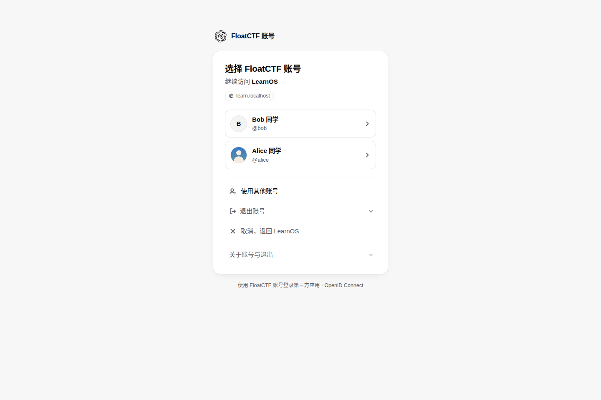 | 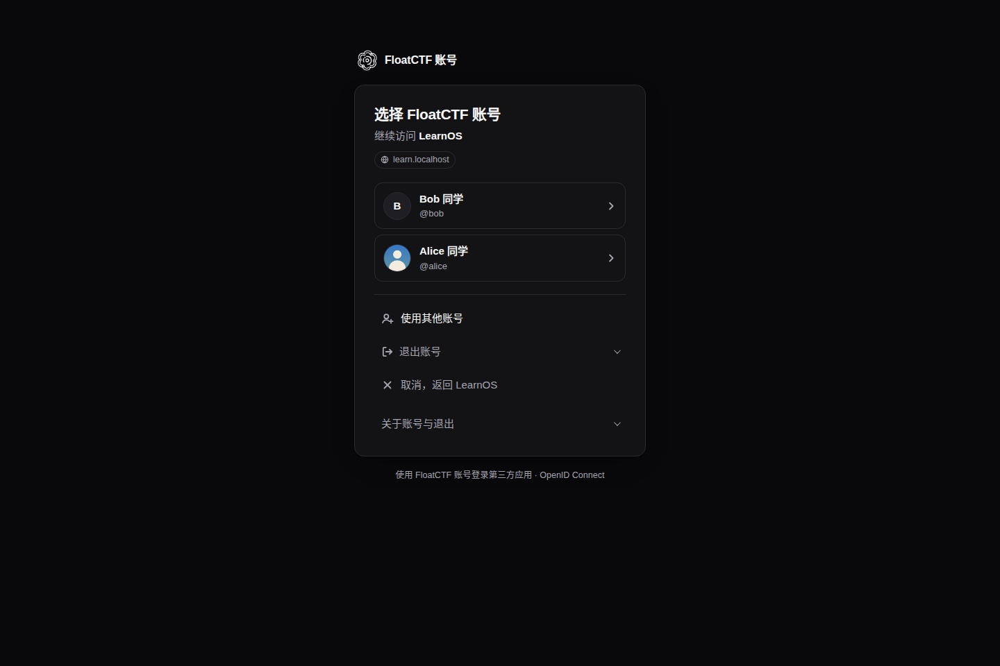 |
| 选择账号（移动 390px） | 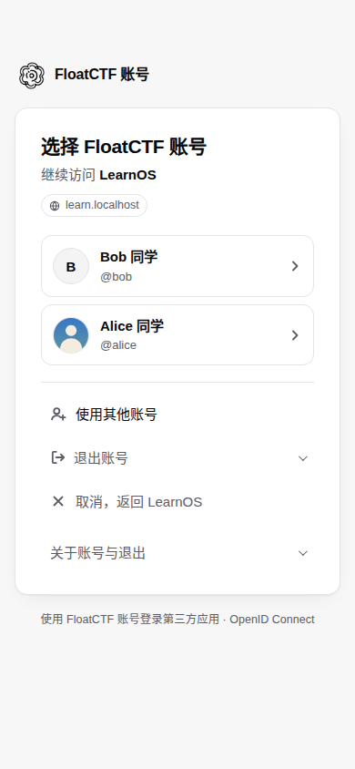 | 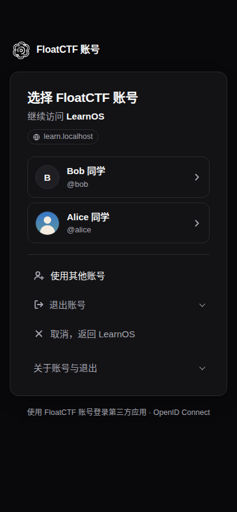 |
| 「退出账号」展开（390px） | 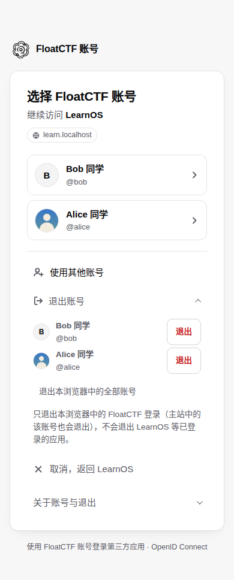 | 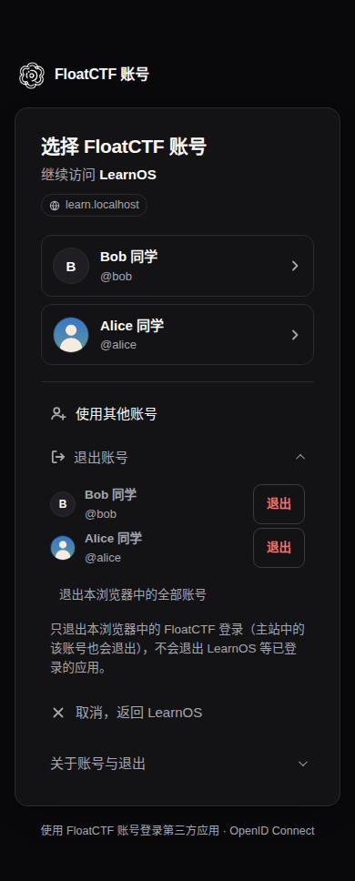 |
| 授权同意 | 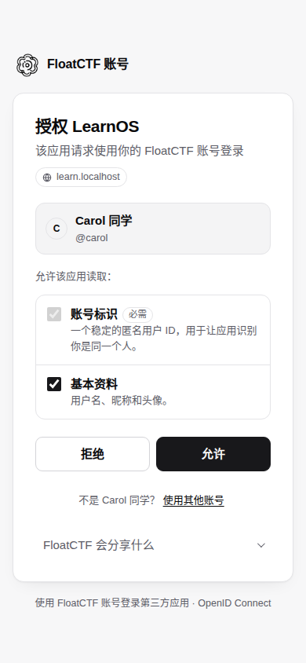 | 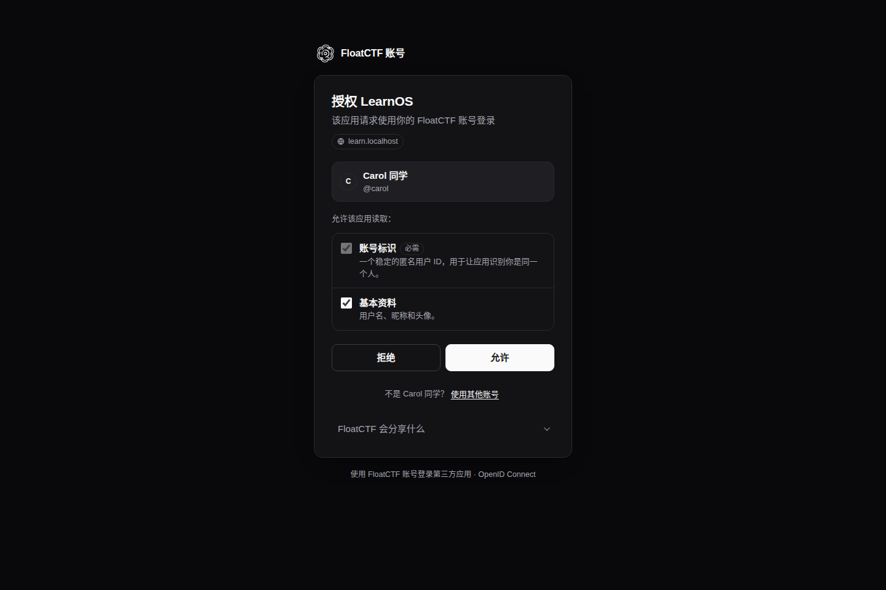 |
| 登录 / 登录失败 | 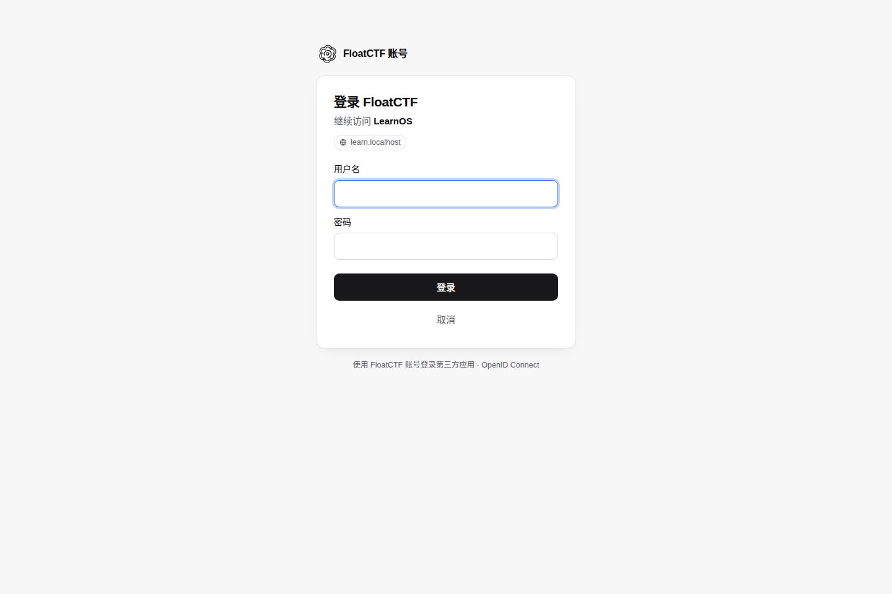 | 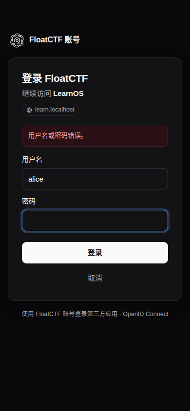 |
| RP 发起的退出确认 | 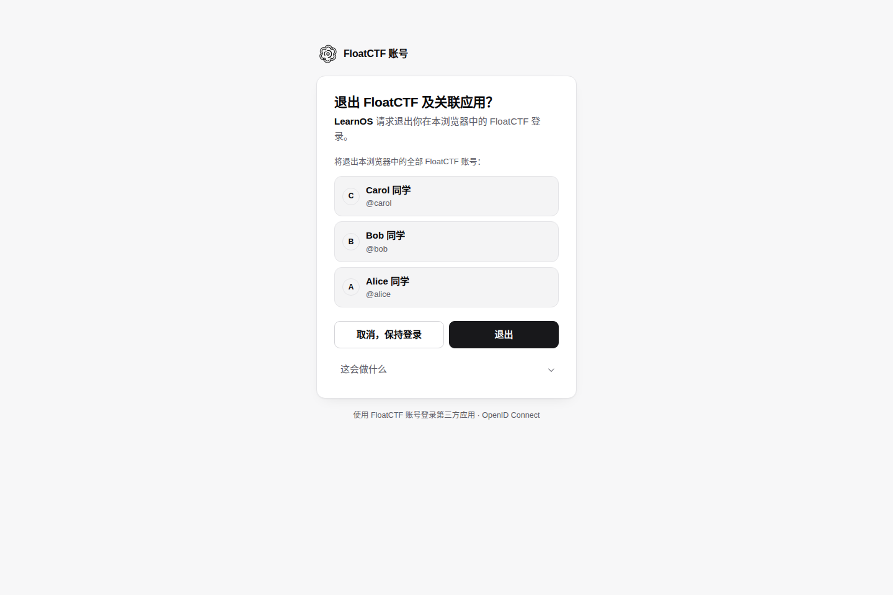 | 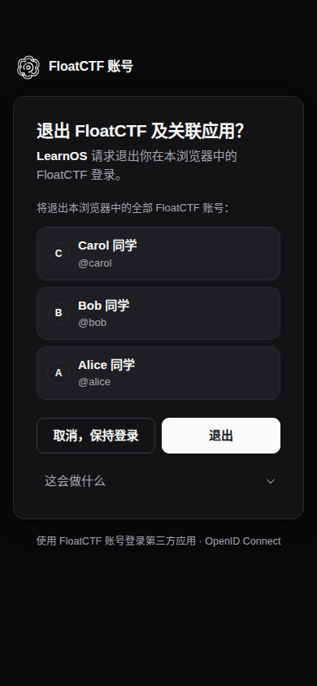 |
| 单账号 320px / 错误页 768px | 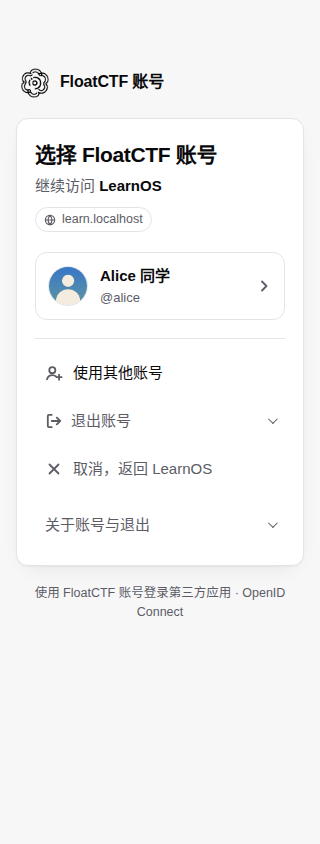 | 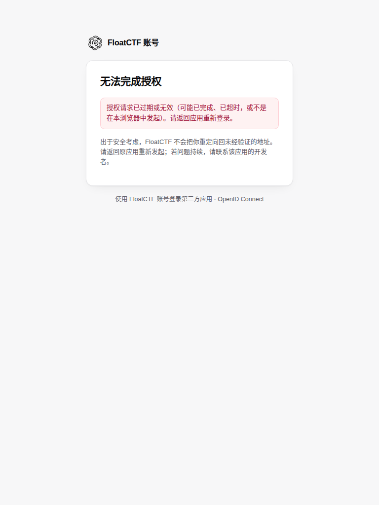 |

主站：账号菜单（两个账号）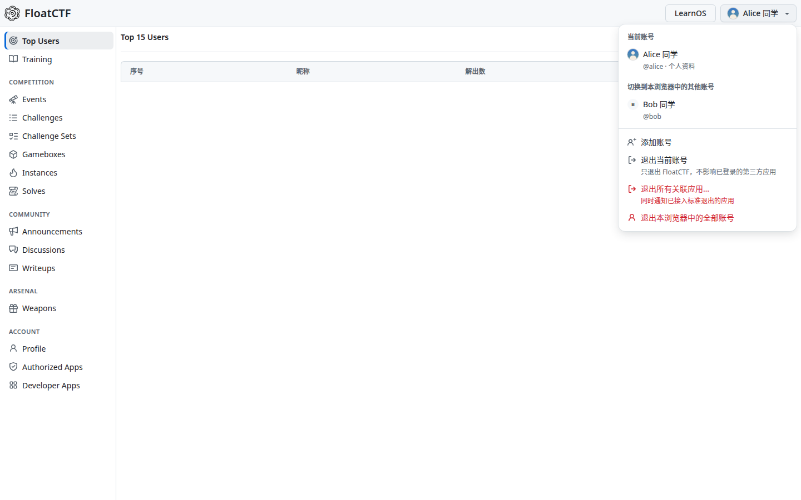
「退出所有关联应用」确认与逐应用结果 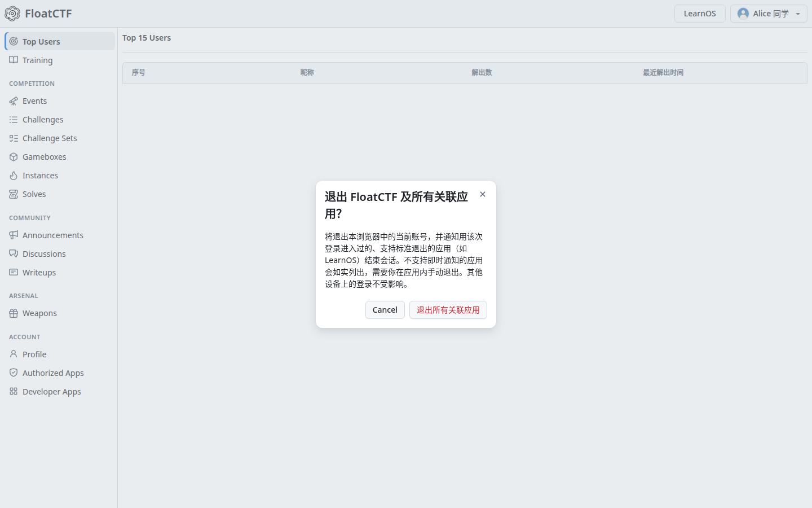 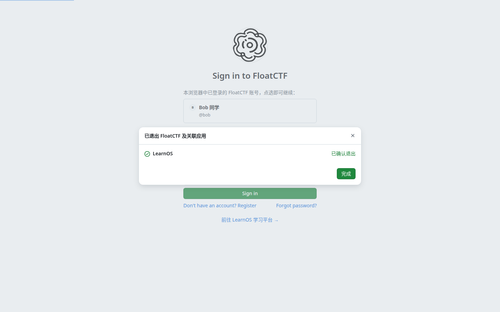
退出当前账号后让用户明确选择剩余账号 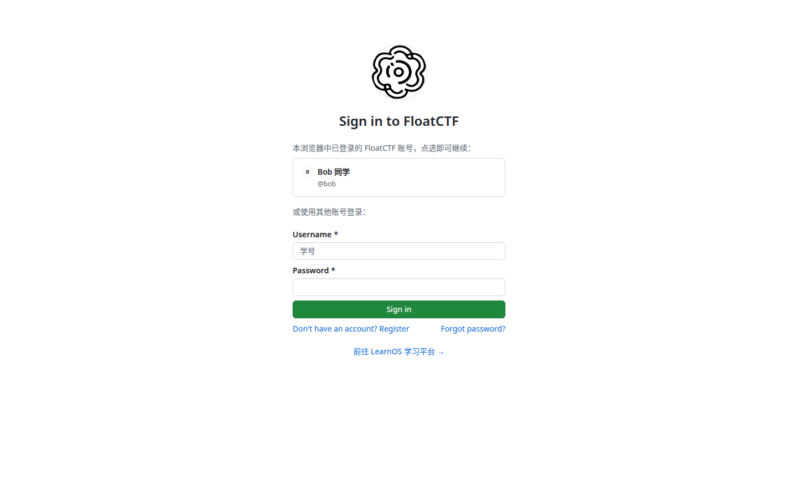；头像失效时回退首字母 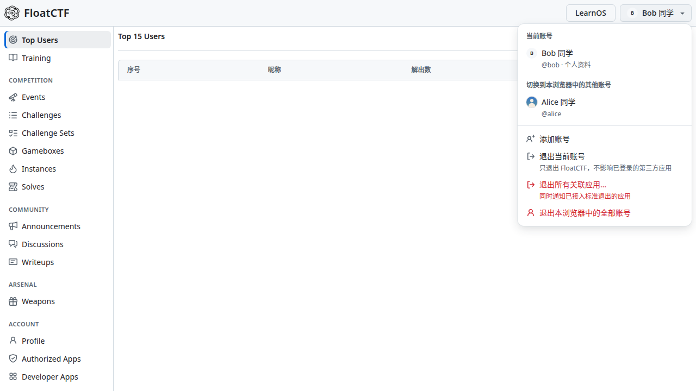

### 9.5 迁移、备份与回滚演练（本地一次性库）

- 用 upstream/main（`64cb4bb`，含已上线的账号选择迁移）的 `migrate.sh` 建出升级前库，写入代表性数据（用户、机密应用、授权、旧单会话），
  `pg_dump --format=custom` 备份。
- 本分支 `migrate.sh apply`：Applied 2 / Pending 0；`verify` OK；用户 / 应用 / 授权 / 会话行数不变；旧会话自动获得 `sid`、`container_id` 为空；
  应用的 `post_logout_redirect_uris = []`、`backchannel_logout_uri = null`；两份新迁移手工重放均 exit 0（幂等）。
- `pg_restore` 到新库：数据与升级前一致、`oidc_browser_containers` 不存在、`migrate.sh status` 显示 2 个 pending——备份可恢复到升级前。
- **代码回滚**：upstream/main（1.0.2，`64cb4bb`）的 API 二进制直接运行在已迁移的库上：正常启动；Discovery 不宣告 `end_session_endpoint`；
  注册、口令登录（下发旧版 `fctf_sso`）、Bearer `/api/users/me` 正常；它写入的会话行自动获得 `sid`、`container_id` 为空；升级前的旧会话仍可读取。
  即：回滚代码不需要回滚迁移。

### 9.6 本轮发现并修复的问题

| 提交 | 问题 | 发现方式 |
|------|------|----------|
| `8f12154` | 「退出所有关联应用」成功后主站立即跳回登录页并卸载账号菜单，逐应用结果对话框从未显示 | E2E A13 |
| `667874d` | OP 页面若干触屏目标小于 44px（输入框、「退出」按钮、授权复选框、「使用其他账号」） | 截图审计 |
| `a5515d8` | 主站账号菜单 / 登录页账号选择的头像加载失败时显示破图 | 真实浏览器截图 |
| `33dc1b8` | 顶栏账号按钮中的头像被压成一条线 | 真实浏览器截图 |

### 9.6.1 测试环境注意

- 测试工具若先于 API 建出 `floatctf-public` 桶，桶不会有公开读策略（API 只在自己建桶时设置），`/public/images/*` 返回 403。
  生产由 API 首次建桶，不受影响；测试环境需补策略。上传头像的对象没有设置 `Content-Type`（`application/octet-stream`），属既有行为：
  OP 页面经头像端点按魔数校验并返回正确 MIME，不依赖它。
- 整套 E2E 在同一 IP 上口令登录上百次，只在隔离测试库里调高了 `OIDC_LOGIN_RATE_PER_USER` / `OIDC_LOGIN_RATE_PER_IP`。

### 9.7 未完成 / BLOCKED

1. **生产部署、生产备份与恢复演练、真实双 issuer（`10.66.66.7:8443` / `120.95.81.151`）与公网 HTTPS 域名实测：BLOCKED**——本工作站没有生产主机、数据库与签名私钥的访问权限。命令与顺序见 `oidc-operations.md` §11。
2. OpenID Foundation 一致性套件的 RP-Initiated / Back-Channel Logout 测试计划未运行（Phase 4 只跑了基础 OP 计划）。
3. 生产 10.66 入口的主站与 LearnOS 同主机不同端口，FloatCTF Cookie 会被同主机其他端口的应用收到（ADR §7，既有问题；根治需不同主机名）。
4. 头像上传对象不带 `Content-Type`（既有）；平台没有「停用用户」状态（同 §8.3）。
